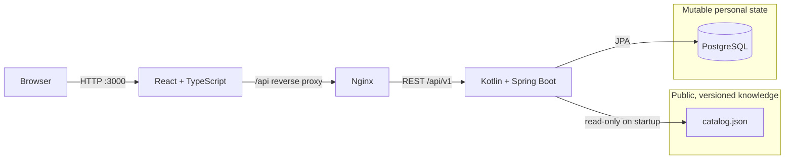
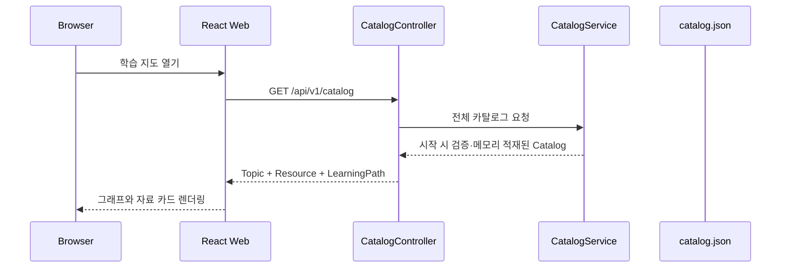
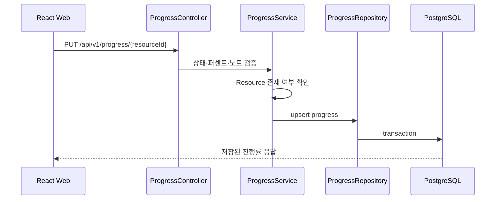

# Dev Learning Atlas

경력직 백엔드 엔지니어를 위한 오픈소스 학습 지도이자 자료 관리 애플리케이션입니다.

책, 강의, 기술 문서, GitHub 저장소와 코딩테스트 문제를 단순히 북마크하는 데서 끝내지 않고, **선행 지식 그래프**, **목표별 학습 경로**, **개인 진행률**로 연결합니다. Karakeep에서는 저장·태깅·재발견이라는 제품 아이디어만 참고했으며 소스 코드는 사용하지 않았습니다.

현재 카탈로그에는 Kotlin/Spring, 시스템 설계, 분산 시스템, 데이터·이벤트 파이프라인, 성능, 배포 플랫폼, 기술 리더십과 알고리즘 학습 자료가 포함됩니다. Algorithms 영역은 프로그래머스 64문제, 카카오·LINE 공개 해설 5개, 난이도별 학습 경로 8개로 구성됩니다.

## 해결하려는 문제

일반적인 북마크 도구는 링크를 저장하지만 다음 질문에는 답하기 어렵습니다.

- 지금 무엇을 먼저 공부해야 하는가?
- 이 주제를 이해하기 위한 선행 지식은 무엇인가?
- 이직 목표별로 어떤 순서로 공부해야 하는가?
- 어느 자료까지 완료했고 무엇을 복습해야 하는가?
- 공개 학습 자료와 개인 학습 기록을 어떻게 분리할 것인가?

Dev Learning Atlas는 공개 지식을 그래프로 구조화하고 개인 진행률을 별도 상태로 관리하여 이 문제를 해결합니다.

## 주요 기능

- React Flow 기반 주제·선행 지식 그래프
- 제목과 설명 검색, 주제·자료 유형 필터
- 책, 강의, 문서, 저장소, 코딩 문제, 실습 자료 지원
- `NOT_STARTED → IN_PROGRESS → COMPLETED` 진행률 관리
- 목표별 순서가 있는 Learning Path
- Git으로 리뷰 가능한 공개 카탈로그
- PostgreSQL에 분리 저장되는 개인 진행 상태
- 밝은 색상 기반 반응형 UI
- 시작 시 ID 중복, 잘못된 참조, 선행 관계 순환 검증

## 시스템 아키텍처

### 전체 구성



Docker Compose에서는 `web`, `api`, `postgres` 세 컨테이너를 하나의 내부 네트워크로 실행합니다. 브라우저는 웹 컨테이너만 바라보고, Nginx가 `/api` 요청을 Spring Boot로 프록시합니다. 따라서 프론트엔드는 배포 환경별 API 호스트를 직접 알 필요가 없습니다.

### 기술 스택

| 영역 | 기술 | 선택 이유 |
|---|---|---|
| Web | React 19, TypeScript, Vite | 컴포넌트 기반 UI, 강한 타입, 빠른 개발·빌드 피드백 |
| Graph | React Flow | 노드·엣지, 확대·축소, 미니맵 등 그래프 상호작용을 검증된 라이브러리로 처리 |
| API | Kotlin 2.4, Spring Boot 4.1, Java 21 | null 안정성, 간결한 도메인 모델, Spring 생태계와 운영 경험 활용 |
| Persistence | Spring Data JPA, PostgreSQL 17 | 개인 진행 상태의 트랜잭션과 향후 사용자 단위 확장에 적합 |
| Local DB | H2 PostgreSQL mode | 별도 DB 없이 API 단독 개발 가능 |
| Delivery | Docker, Docker Compose, Nginx | 동일한 실행 환경과 한 번의 명령으로 재현 가능한 전체 스택 |
| CI | GitHub Actions | 프론트 빌드와 API 테스트·컨테이너 빌드를 PR마다 검증 |

## 핵심 설계 결정

### 1. 공개 카탈로그와 개인 상태 분리

이 프로젝트에서 가장 중요한 결정은 모든 데이터를 데이터베이스에 넣지 않은 것입니다.

| 데이터 | 저장소 | 변경 특성 | 장점 |
|---|---|---|---|
| Topic, Resource, Learning Path | `catalog.json` | 공개적이고 비교적 느리게 변경 | Git diff, 코드 리뷰, fork와 PR 기여가 쉬움 |
| Learning Progress | PostgreSQL | 개인적이고 자주 변경 | 트랜잭션, 조회, 사용자별 확장이 쉬움 |

카탈로그까지 DB에 넣으면 오픈소스 기여자가 데이터베이스 덤프나 관리 UI를 통해 자료를 수정해야 합니다. 반대로 진행률까지 파일에 저장하면 동시성, 사용자별 격리와 동기화가 어려워집니다. 두 데이터의 소유권과 변경 주기가 다르므로 저장 방식도 분리했습니다.

이 결정은 [ADR-001](docs/adr/0001-catalog-and-progress-separation.md)에 기록되어 있습니다.

### 2. 마이크로서비스보다 모듈형 모놀리스

MVP는 하나의 Spring Boot 애플리케이션 안에서 `catalog`와 `progress` 패키지를 분리합니다. 현재 트래픽과 팀 규모에서 마이크로서비스는 배포, 관측, 장애 처리와 데이터 일관성 비용만 증가시킬 가능성이 큽니다.

경계는 코드 수준에서 먼저 명확히 만들고, 독립적인 확장 요구나 팀 소유권이 생길 때 서비스 분리를 검토하는 전략입니다.

### 3. 서버 시작 시 카탈로그 검증

외부 링크 모음은 데이터가 많아질수록 다음 오류가 발생하기 쉽습니다.

- Topic, Resource, Path ID 중복
- 존재하지 않는 Topic이나 Resource 참조
- 빈 Learning Path
- 자기 자신 또는 순환하는 선행 관계
- 잘못된 학습 시간 값

`CatalogValidator`가 애플리케이션 시작 시 이를 검사하고 오류가 있으면 빠르게 실패합니다. 잘못된 그래프를 조용히 서비스하는 것보다 배포 단계에서 즉시 발견하는 편이 안전합니다.

### 4. 단일 사용자 MVP

초기 버전에는 인증과 권한 모델을 넣지 않았습니다. 핵심 가설은 “학습 그래프와 진행률이 실제로 유용한가”이므로 OAuth, 세션, 계정 복구 같은 부가 복잡도를 미뤘습니다.

향후 `learning_progress`에 `user_id`를 추가하고 GitHub OAuth를 적용할 수 있도록 공개 카탈로그와 개인 상태의 경계를 이미 분리해 두었습니다.

## 요청 흐름

### 카탈로그 조회



카탈로그는 애플리케이션 시작 시 한 번 읽고 검증한 뒤 메모리에 보관합니다. 현재 규모에서는 요청마다 파일을 읽거나 별도 캐시를 운영할 필요가 없습니다.

### 진행률 변경



존재하지 않는 자료의 진행률은 저장하지 않으며 퍼센트는 0~100으로 검증됩니다.

## 도메인 모델

| 모델 | 주요 필드 | 역할 |
|---|---|---|
| `Topic` | `id`, `parentId`, `prerequisiteIds`, `position` | 학습 영역의 계층과 선행 관계 표현 |
| `LearningResource` | `url`, `type`, `difficulty`, `topicIds`, `estimatedMinutes` | 실제 학습 자료와 검색 메타데이터 |
| `LearningPath` | `resourceIds` | 목표에 맞는 순서형 커리큘럼 |
| `LearningProgress` | `resourceId`, `status`, `percentage`, `note`, `updatedAt` | 사용자의 가변 학습 상태 |

`parentId`는 분야의 소속 관계이고 `prerequisiteIds`는 학습 순서를 뜻합니다. 두 관계를 분리하여 “Spring은 Backend Engineering에 속한다”와 “Spring을 배우기 전에 Java/Kotlin이 필요하다”를 각각 표현합니다.

## 코드 구조

```text
dev-learning-atlas/
├── apps/
│   ├── api/
│   │   ├── src/main/kotlin/dev/learningatlas/
│   │   │   ├── catalog/        # 카탈로그 로딩·검증·조회 API
│   │   │   ├── progress/       # 진행률 도메인·JPA·명령 API
│   │   │   └── config/         # CORS 등 웹 설정
│   │   └── src/main/resources/
│   │       ├── data/catalog.json
│   │       └── application.yml
│   └── web/
│       ├── src/App.tsx          # 지도·자료실·학습 경로 UI
│       ├── src/api.ts           # REST 클라이언트
│       ├── src/types.ts         # API 계약 타입
│       └── src/styles.css       # 반응형 밝은 테마
├── docs/
│   ├── adr/                     # 아키텍처 결정 기록
│   └── algorithm-roadmap.ko.md # 알고리즘 로드맵 원본
├── scripts/                     # 카탈로그 가져오기 도구
├── .github/workflows/ci.yml
└── docker-compose.yml
```

## API

| Method | Endpoint | 설명 |
|---|---|---|
| `GET` | `/api/v1/catalog` | 전체 Topic, Resource, Learning Path 조회 |
| `GET` | `/api/v1/resources?query=&topicId=&type=&difficulty=&language=` | 제목·주제·유형·난이도·언어별 자료 검색 |
| `GET` | `/api/v1/progress` | 전체 진행률 조회 |
| `PUT` | `/api/v1/progress/{resourceId}` | 특정 자료의 상태·퍼센트·노트 저장 |
| `GET` | `/actuator/health` | 애플리케이션 상태 확인 |

예를 들어 중급 한국어 자료만 조회하려면 `GET /api/v1/resources?difficulty=INTERMEDIATE&language=ko`를 사용합니다.

## 실행 방법

### 전체 스택

요구사항: Docker Desktop과 Docker Compose.

```bash
docker compose up --build
```

- Web: http://localhost:3000
- API: http://localhost:8080/api/v1/catalog
- Health: http://localhost:8080/actuator/health

종료할 때 데이터 볼륨을 유지하려면 다음 명령을 사용합니다.

```bash
docker compose down
```

### API 단독 개발

Java 21과 Gradle이 필요합니다. 기본 프로필은 H2를 사용합니다.

```bash
cd apps/api
gradle bootRun
```

### Web 단독 개발

Node.js 22가 필요합니다. Vite가 `/api`를 `http://localhost:8080`으로 프록시합니다.

```bash
cd apps/web
npm install
npm run dev
```

## 알고리즘 로드맵 관리

원본 Markdown은 `docs/algorithm-roadmap.ko.md`에 보관합니다. 다음 명령은 표의 문제 링크, 유형, 목표 시간과 기업 공개 자료를 `catalog.json`으로 가져옵니다.

```bash
node scripts/import-algorithm-roadmap.mjs
```

가져오기 스크립트는 URL 기준으로 기존 자료를 갱신하므로 반복 실행해도 중복되지 않습니다. 예상 문제 64개와 공개 자료 5개가 일치하지 않으면 파일을 쓰기 전에 실패합니다.

## 품질 전략

- `CatalogValidatorTest`: 정상 그래프와 순환·잘못된 참조 거부 검증
- `AtlasApplicationTest`: Spring 전체 컨텍스트, 카탈로그 로딩, 알고리즘 자료 수 검증
- Docker API 빌드에서 `clean test bootJar` 실행
- Web 빌드에서 TypeScript 프로젝트 검사 후 Vite 프로덕션 번들 생성
- GitHub Actions에서 API 컨테이너 빌드와 Web `npm ci && npm run build` 병렬 검증
- 컨테이너는 root 사용자가 아닌 전용 `atlas` 사용자로 API 실행

## 보안과 운영 고려사항

현재 버전은 로컬 단일 사용자 MVP입니다. 공개 배포 전에는 다음 항목이 필요합니다.

- Spring Security와 OAuth/OIDC 인증
- 사용자별 Progress 소유권 검사
- 운영 시크릿을 Compose 파일이 아닌 Secret Manager로 이전
- JPA `ddl-auto` 대신 Flyway 버전 마이그레이션
- 링크 입력에 대한 URL scheme·도메인 정책과 SSRF 방어
- API rate limit과 요청 크기 제한
- OpenTelemetry 기반 trace·metric·log 상관관계
- SLO, 경보, 백업과 복구 훈련

## 확장 로드맵

1. **Multi-user:** GitHub OAuth, `user_id` 기반 진행률 격리
2. **Database lifecycle:** Flyway와 운영 환경별 마이그레이션 전략
3. **Search:** PostgreSQL FTS로 시작하고 규모가 커지면 OpenSearch 검토
4. **Review:** D+1/D+7/D+30 간격 반복과 오답 노트
5. **Import:** 브라우저 북마크와 CSV 가져오기
6. **Sharing:** 버전이 있는 공개 Learning Path 공유
7. **Reliability:** OpenTelemetry, 대시보드, SLO, 장애 대응 Runbook
8. **AI assistance:** 사람이 승인하는 태그·요약 추천만 선택적으로 도입

## 면접에서 설명할 수 있는 포인트

- 데이터의 소유권과 변경 주기를 기준으로 JSON과 PostgreSQL을 분리한 이유
- 계층 관계와 선행 관계를 별도 엣지로 모델링한 이유
- 마이크로서비스를 선택하지 않은 근거와 향후 분리 조건
- 시작 시 검증으로 잘못된 그래프를 빠르게 실패시키는 방식
- 단일 사용자 MVP에서 다중 사용자 서비스로 확장하는 데이터 모델
- CI, 컨테이너 비루트 실행, Health Check로 만든 최소 운영 기준
- 검색, 캐시, 인증, 관측성을 트래픽과 요구사항에 따라 점진적으로 도입하는 전략

## 의도적으로 제외한 범위

- 서버 측 웹페이지 아카이빙
- 실시간 협업
- 자동 AI 분류·요약
- 분산 캐시와 메시지 브로커
- 근거 없는 마이크로서비스 분리

첫 릴리스의 핵심 가치를 검증하고 한 명의 유지관리자가 운영할 수 있도록 범위를 제한했습니다.

## 참고 프로젝트

- [diagram-design](https://github.com/cathrynlavery/diagram-design): 편집 가능한 다이어그램의 시각 원칙 참고, MIT. 소스 코드는 복사하지 않았습니다.
- [Karakeep](https://karakeep.app/): 저장, 태깅, 재발견 기능의 제품 아이디어 참고. 소스 코드는 사용하지 않았습니다.
- [React Flow](https://reactflow.dev/): MIT 라이선스의 인터랙티브 노드 그래프 라이브러리.

## 기여

[CONTRIBUTING.md](CONTRIBUTING.md)와 [SECURITY.md](SECURITY.md)를 확인해 주세요. 카탈로그 변경은 안정적인 URL, 명확한 Topic, 비제휴 링크와 비순환 선행 관계를 요구합니다.

## License

MIT
